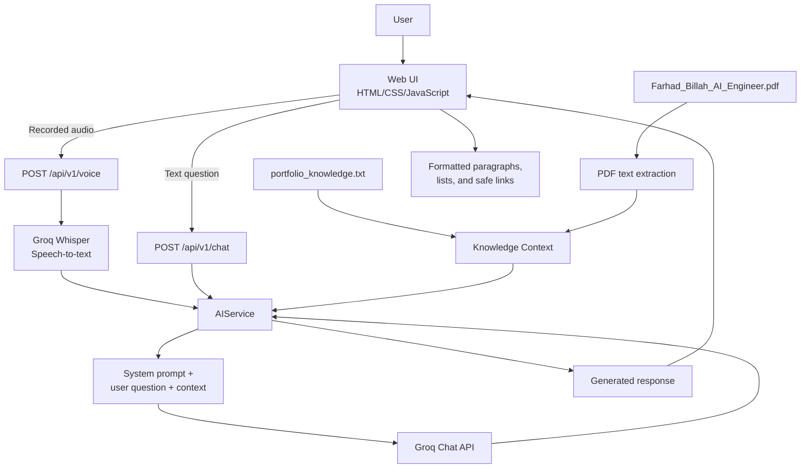

# Farhad's Little Lab Chatbot

Farhad's Little Lab is a portfolio-aware AI assistant built with FastAPI. It
answers questions about Md. Farhad Billah's background, education, skills,
projects, publications, and contact information. It supports both text chat
and voice input.

The assistant uses Groq for chat generation and Whisper through Groq for
speech-to-text. Its answers are grounded in the local portfolio knowledge base
and the bundled CV PDF.

## Features

- Portfolio-aware answers about Farhad Billah
- Knowledge from `Data/portfolio_knowledge.txt`
- Text extracted from `Data/Farhad_Billah_AI_Engineer.pdf`
- Tolerant of spelling mistakes, grammar mistakes, incomplete sentences, and
  informal phrasing
- Text chat through the web interface
- Voice input through browser recording and Groq Whisper transcription
- Text-to-speech support through the existing voice interface
- Markdown-style list formatting rendered as readable HTML lists
- URLs rendered as `Click here` links that open in a new tab
- FastAPI health and model-status endpoints
- Docker support

## How It Works

### Text question

1. The user types a question in the browser.
2. `app/static/js/chat.js` sends the question to `POST /api/v1/chat`.
3. FastAPI validates the request and passes it to `AIService`.
4. `AIService` sends the question, system instructions, and portfolio context
   to Groq.
5. Groq returns an answer grounded in the supplied knowledge.
6. The browser cleans and formats the response:
   - paragraphs remain separate;
   - numbered and bulleted items become HTML lists;
   - URLs become safe links with `target="_blank"`.
7. The formatted answer is displayed in the chat window.

### Voice question

1. The user records audio in the browser.
2. The browser sends the audio file to `POST /api/v1/voice`.
3. Groq Whisper converts the audio into text.
4. The transcribed text is passed through the same portfolio-aware chat flow.
5. The API returns the transcript and generated answer.
6. The browser displays the answer and can use the response for speech output.

### Understanding imperfect input

The system prompt instructs the AI to infer the user's intended meaning when
there are obvious spelling errors, grammar errors, missing words, unusual word
order, or informal phrasing. The assistant answers directly when the meaning is
clear and asks for clarification only when the question is genuinely
ambiguous.

## System Architecture



### Main components

| Component | Responsibility |
| --- | --- |
| `app/main.py` | Creates the FastAPI application, mounts static files, and serves the web page |
| `app/api/routes.py` | Registers chat, voice, health, and model-status endpoints |
| `app/services/ai_service.py` | Loads knowledge, extracts PDF text, calls Groq Chat and Whisper APIs |
| `app/static/js/chat.js` | Sends chat requests and renders paragraphs, lists, and links |
| `app/static/js/voice.js` | Records audio and handles voice interaction |
| `app/static/css/styles.css` | Defines the chat interface and formatted response styling |
| `app/templates/index.html` | Provides the web interface |
| `Data/portfolio_knowledge.txt` | Main structured portfolio knowledge source |
| `Data/Farhad_Billah_AI_Engineer.pdf` | Additional CV knowledge source |

## Project Structure

```text
Farhads little lab chatbot/
├── app/
│   ├── api/
│   │   ├── routes.py
│   │   └── endpoints/
│   ├── core/
│   ├── models/
│   ├── services/
│   │   ├── ai_service.py
│   │   ├── chat_service.py
│   │   ├── speech_recognition.py
│   │   └── text_to_speech.py
│   ├── static/
│   │   ├── css/
│   │   └── js/
│   ├── templates/
│   └── main.py
├── Data/
│   ├── Farhad_Billah_AI_Engineer.pdf
│   └── portfolio_knowledge.txt
├── tests/
├── Dockerfile
├── docker-compose.yml
├── requirements.txt
└── README.md
```

## Installation

### 1. Create and activate a virtual environment

Windows:

```powershell
python -m venv venv
venv\Scripts\activate
```

macOS or Linux:

```bash
python3 -m venv venv
source venv/bin/activate
```

### 2. Install dependencies

```bash
pip install -r requirements.txt
```

### 3. Configure environment variables

Create a `.env` file in the project root:

```env
GROQ_API_KEY=your_groq_api_key
GROQ_MODEL=openai/gpt-oss-120b
```

Never commit a real API key to source control. Use `.env.example` as a
template.

## Running the Application

Start the development server:

```bash
uvicorn app.main:app --reload --host 0.0.0.0 --port 8061
```

Open the web interface at:

```text
http://127.0.0.1:8061/
```

Interactive API documentation is available at:

```text
http://127.0.0.1:8061/docs
```

## Docker

```bash
docker-compose up --build
```

## API Endpoints

### `POST /api/v1/chat`

Send a text question:

```json
{
  "message": "What projects has Farhad worked on?",
  "session_id": "default"
}
```

Successful response:

```json
{
  "success": true,
  "response": "..."
}
```

### `POST /api/v1/voice`

Upload an audio file using multipart form data with the field name
`audio_file`. The response includes the transcript and the AI answer.

### `GET /api/v1/models`

Returns the configured chat model, Whisper model, and API configuration
status.

### `GET /api/v1/health`

Returns the service health status.

## Testing

Run the test suite with:

```bash
pytest
```

## Troubleshooting

- **The chat shows a generic error:** check `GROQ_API_KEY`, confirm the server
  has been restarted, and review the FastAPI logs for the upstream Groq error.
- **The PDF is not used:** confirm that
  `Data/Farhad_Billah_AI_Engineer.pdf` exists and that `pypdf` is installed.
- **The browser shows an old interface:** hard-refresh the page after changing
  JavaScript or CSS files.
- **The response is not current:** update the local knowledge files and
  restart the application so the context is loaded again.

## License

This project is intended for Farhad Billah's portfolio and demonstration use.
